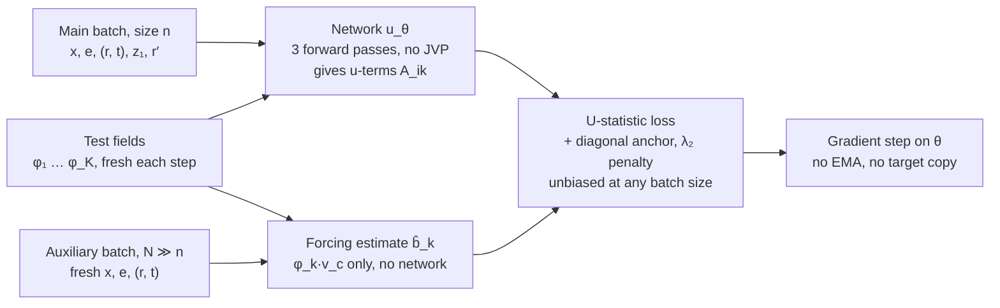

# Weak-Form MeanFlow: A Consistent Proposal

*21 October 2026*

## Summary

Train the MeanFlow average velocity $u(z,r,t)$ by driving a weak-form residual to zero under random test fields, with the per-sample velocity $e-x$ plugged in directly. That one change gives the four properties the earlier five-part stack was after, without the parts that failed verification.

What the proposal claims:

1. **No JVP.** The loss never differentiates $u$. All derivatives land on test fields whose gradients are analytic and cheap.
2. **No chasing target.** There is no stop-gradient copy of the network, no EMA, and no teacher. The only velocity used is the data quantity $e-x$, and the weak residual stays unbiased with it.
3. **Linear stationarity.** The population loss is a convex quadratic functional of $u$. Its first-order condition is linear in $u$, and for a linear readout the minimizer has a closed form.
4. **Identifiability.** If the test-field distribution has a strictly positive-definite covariance kernel, the only square-integrable zero of the loss is the true average velocity $u^*$. The diagonal condition $u(z,t,t)=v(z,t)$ follows; it does not need to be imposed.

What it does not claim: lower variance than MeanFlow at equal batch size, or a loss that is literally linear. Variance work here is limited to removing small-batch bias exactly and cutting the noise of the $u$-independent term.

Dropped from the earlier stack after verification: common-random-number moment matching (its variance does not vanish at $u^*$, and linear tests only constrain the mean), moment-level semigroup consistency (it is a linear combination of constraints already imposed), and the linear-readout operator built on a frozen flow (it reintroduces a teacher). Section 10 gives the reasons.

## Setup and notation

Data sits at $t=0$ and noise at $t=1$. Draw $x$ from the data, $e\sim\mathcal N(0,I)$ independently, and form the straight path with its per-sample velocity:

$$
z_t=(1-t)\,x+t\,e,\qquad v_c=e-x,\qquad t\in[0,1].
$$

Let $\mu_t$ be the law of $z_t$, so $\mu_1=\mathcal N(0,I)$ exactly. The marginal velocity is the conditional mean of the per-sample velocity, and it satisfies the continuity equation:

$$
v(z,t)=\mathbb E[v_c\mid z_t=z],\qquad \partial_t\mu_t+\nabla\!\cdot(v\,\mu_t)=0.
$$

Write $\Phi_{s,t}$ for the flow of $v$ that maps a point at time $t$ to time $s$. On the triangle $0\le r<t\le 1$, the average velocity and its one-step map are

$$
u^*(z,r,t)=\frac{1}{t-r}\int_r^t v\bigl(\Phi_{\tau,t}(z),\tau\bigr)\,d\tau,\qquad \Phi_{r,t}(z)=z-(t-r)\,u^*(z,r,t).
$$

With $r$ held fixed, write $D_t=\partial_t+v\cdot\nabla_z$ for the derivative along the flow. Differentiating $(t-r)u^*$ along a trajectory gives the MeanFlow identity, and the residual of a candidate field $u$ is

$$
R(u)=u-v+(t-r)\,D_t u,\qquad D_t=\partial_t+v\cdot\nabla_z,\qquad R(u^*)=0.
$$

Original MeanFlow regresses $u_\theta$ onto a stop-gradient copy of $v_c-(t-r)D_t u_\theta$. Computing that target needs a JVP of the network, and the target moves with the network. Both issues come from evaluating $D_t u$. The proposal never does.

Worked case used throughout: for one-dimensional Gaussian data $x\sim\mathcal N(0,s^2)$,

$$
\sigma_t^2=(1-t)^2s^2+t^2,\qquad u^*(z,r,t)=\Bigl(1-\frac{\sigma_r}{\sigma_t}\Bigr)\frac{z}{t-r},
$$

and the field $v$ is linear in $z$.

## Core result: the weak residual

Testing the residual against a smooth vector field $\varphi(z,r,t)$ and integrating by parts moves every derivative off $u$. The result can be estimated from samples using $e-x$, with no bias.

For smooth $u$, define the weak residual over the whole triangle of $(r,t)$:

$$
W(\varphi;u)=\int_0^1\!\int_r^1\!\int \varphi(z,r,t)\cdot R(u)(z,r,t)\;\mu_t(dz)\,dt\,dr .
$$

**Proposition 1 (weak identity).** Assume $\varphi$ and its first derivatives are bounded, and that $u$ and $v$ have finite second moments under $\mu_t$. Then

$$
\begin{aligned}
W(\varphi;u)={}&-\iiint \varphi\cdot v\;d\mu_t\,dt\,dr
\;-\iiint (t-r)\,u\cdot D_t\varphi\;d\mu_t\,dt\,dr\\
&+\int_0^1(1-r)\int \varphi(z,r,1)\cdot u(z,r,1)\,\mu_1(dz)\,dr ,
\end{aligned}
$$

where $D_t\varphi=\partial_t\varphi+(v\cdot\nabla_z)\varphi$ is applied component by component.

*Proof.* Integrate $(t-r)\,\varphi\cdot D_t u$ by parts in $z$ and in $t$, then use the continuity equation. The term $-\int\varphi\cdot u$ that this produces cancels the $+\int\varphi\cdot u$ in $R(u)$, leaving only the forcing term in $v$. The boundary at $t=r$ vanishes because of the factor $t-r$. The boundary at $t=1$ is the last term. ∎ A one-dimensional quadrature check with a nonlinear $u$ and $\varphi(\cdot,1)\neq 0$ matches both sides at 0.05134.

The right-hand side is the *definition* of $W$ for any $u$ that is square-integrable under $\mu_t\,dt\,dr$. No derivative of $u$ appears in it.

**Proposition 2 (no target needed).** Every term on the right is linear in $v$, multiplied by a function of $(z_t,r,t)$ alone. By the tower property, replacing $v$ by $v_c=e-x$ inside the expectation over $(x,e)$ leaves $W$ unchanged. Sampling $(r,t)$ uniformly on the triangle, $r'$ uniformly on $[0,1]$, and $z_1\sim\mathcal N(0,I)$, define the per-sample integrand

$$
\begin{aligned}
g(\xi;\varphi,u)={}&\tfrac12\Bigl[-\varphi\cdot v_c-(t-r)\,u(z_t,r,t)\cdot\bigl(\partial_t\varphi+(v_c\cdot\nabla_z)\varphi\bigr)\Bigr]_{(z_t,r,t)}\\
&+(1-r')\,\varphi(z_1,r',1)\cdot u(z_1,r',1).
\end{aligned}
$$

Then $\mathbb E[g]=W(\varphi;u)$ exactly. The factor $1/2$ is the area of the triangle. Monte Carlo with $v_c$ gave $0.05152\pm0.0002$, against $0.05159$ with the exact $v$. This is the same tower-property argument that makes conditional flow matching unbiased.

The earlier proposal said a per-sample velocity biases the weak residual. That was wrong. Bias appears only when $v$ is replaced by a field that is *not* the marginal velocity of the $\mu_t$ being sampled, such as a learned field, an EMA, or a frozen pretrained flow.

**Proposition 3 (affine in $u$, for any test field).** Write $W(\varphi;u)=\ell_\varphi(u)-b_\varphi$. Here $\ell_\varphi$ is linear in $u$ and collects the transport term and the boundary term. The forcing term $b_\varphi=\mathbb E[\varphi\cdot v_c]$ does not depend on $u$. This holds for every $\varphi$, not only for linear test functions, which is the key difference from moment matching.

**The loss.** Let $\nu$ be a distribution over test fields. The population objective is

$$
\mathcal L(u)=\mathbb E_{\varphi\sim\nu}\bigl[W(\varphi;u)^2\bigr]=\mathbb E_{\varphi\sim\nu}\bigl[(\ell_\varphi(u)-b_\varphi)^2\bigr].
$$

This is a convex quadratic functional of $u$. Equivalently, it is the squared norm of $R(u)$ in the dual norm induced by the kernel $k=\mathbb E_\nu[\varphi\otimes\varphi]$. The stationary condition is linear in $u$:

$$
\mathbb E_{\varphi\sim\nu}\bigl[(\ell_\varphi(u)-b_\varphi)\,\ell_\varphi\bigr]=0 .
$$

For a neural network, the loss is non-convex in $\theta$ but convex in the function $u$. That is the same situation as flow matching.

## Identifiability

With a rich enough family of test fields, zero loss pins down $u^*$ among square-integrable fields. The diagonal condition then comes for free. The identification is exact but not uniformly stable near $t=r$.

**Proposition 4 (unique zero; proof sketch).** Suppose the covariance kernel $k=\mathbb E_\nu[\varphi\otimes\varphi]$ is strictly positive definite on the open triangle times $\mathbb R^d$. An example is random Fourier features in $z$ with a full-support frequency density, multiplied by a complete basis in $(r,t)$. Let $u$ be square-integrable under $\mu_t\,dt\,dr$. Then $\mathcal L(u)=0$ implies $u=u^*$ almost everywhere.

*Sketch.* $\mathcal L(u)=0$ forces $W(\varphi;u)=0$ for a dense set of interior test fields, so $R(u)=0$ in the weak sense. Along a characteristic of $v$ with $r$ fixed, $R(u)=0$ says $\frac{d}{dt}\bigl[(t-r)u\bigr]=v$. The general solution is $u^*$ plus a homogeneous mode:

$$
u=u^*+\frac{c\bigl(\Phi_{r,t}(z),\,r\bigr)}{t-r},
$$

$$
\int_r^1\!\!\int\Bigl|\frac{c(\Phi_{r,t}(z),r)}{t-r}\Bigr|^2\mu_t(dz)\,dt=\|c(\cdot,r)\|^2_{L^2(\mu_r)}\int_r^1\frac{dt}{(t-r)^2}=\infty .
$$

The equality holds because $\Phi_{r,t}$ pushes $\mu_t$ forward to $\mu_r$. So square-integrability forces $c=0$, and $u=u^*$. The field $u^*$ is itself square-integrable, since by Jensen its norm is at most that of $v$, which is at most $\mathbb E|e-x|^2$. ∎

**Consequences.**

- **The diagonal condition is implied.** Since $u=u^*$, it follows that $u(z,t,t)=v(z,t)$. The earlier claim that this must be imposed separately is not needed in the population limit.
- **Finite families leave a null space.** A fixed set of $K$ test fields gives $K$ scalar constraints. Resampling fresh test fields at every step makes the stochastic objective target $\mathcal L(u)$ with the full kernel.
- **No uniform stability near the diagonal.** Smoothly truncating the homogeneous mode at width $\varepsilon$ gives a perturbation with $L^2$ norm of order $\varepsilon^{-1/2}$, while its weak residual stays of order one. So no single constant bounds the error $\|u-u^*\|$ by the loss uniformly as $t-r\to0$. The bounded input-smoothness of the network excludes such modes in practice. The proposal adds two explicit guards: a diagonal anchor and a small $L^2$ penalty on $u$ (Section 6).
- **Scope of the claim.** This is identification of the MeanFlow equation in weak form. It is not a pushforward-measure statement, so the reflection ambiguity that affected moment matching does not arise.

## Estimator and variance

The loss is the square of an expectation, so the naive plug-in estimate is biased at small batch sizes. A U-statistic removes that bias exactly. Two further steps then reduce the noise.

**Step 1: U-statistic (always on).** Draw $K$ test fields $\varphi_1,\dots,\varphi_K$ from $\nu$ and share them across a batch of $n$ independent samples $\xi_i$. Each sample is a tuple $(x,e,r,t,z_1,r')$. With $g_{ik}=g(\xi_i;\varphi_k,u)$,

$$
\widehat{\mathcal L}=\frac1K\sum_{k=1}^K\frac{\bigl(\sum_i g_{ik}\bigr)^2-\sum_i g_{ik}^2}{n(n-1)},\qquad \mathbb E\,\widehat{\mathcal L}=\mathcal L(u),\qquad \mathbb E\,\nabla\widehat{\mathcal L}=\nabla\mathcal L(u).
$$

The plug-in estimate $\bigl(\tfrac1n\sum_i g_{ik}\bigr)^2$ overshoots by $\operatorname{Var}(g)/n$. That bias depends on $u$, so at small $n$ it moves the minimizer away from $u^*$, toward fields that reduce per-sample noise. The U-statistic can be negative on a given batch, which is harmless for gradient steps.

**Step 2: decoupled forcing (always on).** Split $g$ into a part that depends on $u$ and the forcing part $\tfrac12\varphi\cdot v_c$, which does not. Write $W_k=A_k(u)-b_k$. The forcing mean $b_k$ needs no network evaluation, only $\varphi_k$ at sampled points. Estimate it from an auxiliary batch of $N\gg n$ fresh samples, independent of the main batch. Then use

$$
\widehat{\mathcal L}=\frac1K\sum_k\Bigl[\widehat U\bigl(A_k^2\bigr)-2\,\widehat A_k\,\hat b_k+\hat b_k^{\,2}\Bigr].
$$

The gradient stays unbiased because $\hat b_k$ is independent of $\widehat A_k$. The last term is constant in $u$. The noise from the forcing term in the gradient shrinks by about $n/N$, at the cost of $N$ cheap test-field evaluations.

**Step 3: Rao–Blackwellization (only where $v$ is computable).** Replace $v_c$ by $v=\mathbb E[v_c\mid z_t]$ in both places it appears: the forcing term and the transport term $u\cdot(v_c\cdot\nabla)\varphi$. For Gaussian data, $\bigl(z-\mathbb E[x\mid z]\bigr)/t$ gives $v$ exactly. For a Gaussian mixture, weight the components by their responsibilities. For a training set of size $M$, the exact posterior over the set gives the exact marginal of the empirical distribution. That changes nothing about the population objective, but costs $O(M)$ per query. Minibatch self-normalized posteriors are cheaper but biased, so they are an ablation, not a default.

**What is not claimed.** None of these steps is shown to give lower gradient variance than MeanFlow at equal batch size. That comparison is an experiment (Section 11). Common random numbers are not used: at $u^*$ the paired difference does not vanish (Section 10).

## Parameterizations

The same objective trains a neural network by SGD or solves a linear readout in closed form. Both add the same two guards from Section 4:

$$
\mathcal J(u)=\mathcal L(u)+\lambda_a\,\mathbb E\bigl|u(z_t,t,t)-v_c\bigr|^2+\lambda_2\,\|u\|^2_{L^2}.
$$

The anchor term is ordinary flow matching on the diagonal. Its minimizer is $u(\cdot,t,t)=v$, which agrees with $u^*$, so it adds no bias. The $L^2$ penalty does shift the minimizer, by an amount of order $\lambda_2$, so $\lambda_2$ is kept small or annealed to zero. For a network, weight decay plays this role.

**Neural network $u_\theta$.** Each sample needs three forward passes: $u_\theta$ at $(z_t,r,t)$, at $(z_1,r',1)$, and on the diagonal for the anchor. One alternative is to send a fraction of the batch to $r=t$ and use those samples as the anchor. The backward pass goes through these evaluations only. There is no derivative of $u_\theta$ with respect to its inputs and no forward-mode pass. The claim is "no JVP," not "cheaper per step": three forward passes are of the same order as MeanFlow's forward plus JVP, and the comparison is measured in Section 11.

**Linear readout $u_w=\Psi(z,r,t)\,w$.** Here $\Psi$ is a fixed $d\times p$ feature map: random features, or a frozen backbone's last layer. Frozen features shape the function class, not the target, so this is not a teacher. Each sample $i$ and test field $k$ gives one row $\alpha_{ik}\in\mathbb R^p$:

$$
\alpha_{ik}=-\tfrac12(t-r)\,\Psi(z_t,r,t)^{\top}\bigl(\partial_t\varphi_k+(v_c\cdot\nabla_z)\varphi_k\bigr)+(1-r')\,\Psi(z_1,r',1)^{\top}\varphi_k(z_1,r',1).
$$

Accumulate the U-statistic Gram matrix and the right-hand sides across batches, as streaming sums:

$$
G=\frac1K\sum_k\frac{\bigl(\sum_i\alpha_{ik}\bigr)\bigl(\sum_i\alpha_{ik}\bigr)^{\top}-\sum_i\alpha_{ik}\alpha_{ik}^{\top}}{n(n-1)},\qquad h=\frac1K\sum_k\bar\alpha_k\,\hat b_k,
$$

$$
H=\mathbb E\bigl[\Psi(z_t,t,t)^{\top}\Psi(z_t,t,t)\bigr],\qquad c=\mathbb E\bigl[\Psi(z_t,t,t)^{\top}v_c\bigr],\qquad (G+\lambda_aH+\lambda_2 I)\,w=h+\lambda_a c.
$$

This is the normal equation of $\mathcal J$ restricted to the readout. It is linear in $w$, and the solution is unique once $\lambda_2>0$. A single-batch $G$ need not be positive semidefinite, but the accumulated $G$ converges to a PSD matrix. The readout is the cleanest test of the theory. As $K$, $n$ and the number of batches grow and $\lambda_2\to0$, Propositions 2–4 predict that $\Psi w$ converges to the minimizer of $\mathcal J$ over the span of $\Psi$. That minimizer equals $u^*$ exactly whenever $u^*$ lies in the span. Otherwise it is a weighted best approximation in the kernel norm, not the $L^2$ projection.

## Test-field design

Default family: random Fourier features in $z$ times smooth features in time, resampled at every step. These are bounded with bounded derivatives, as Proposition 1 requires, and their gradients cost $O(d)$ each.

$$
\begin{aligned}
\varphi(z,r,t)&=a\,\eta(r,t)\cos(\omega\cdot z+\beta),\\
(v_c\cdot\nabla_z)\varphi&=-a\,\eta(r,t)\sin(\omega\cdot z+\beta)\,(\omega\cdot v_c),\\
\partial_t\varphi&=a\,\partial_t\eta(r,t)\cos(\omega\cdot z+\beta).
\end{aligned}
$$

| Component | Default choice | Why |
| --- | --- | --- |
| Output direction $a$ | Random unit vector in $\mathbb R^d$ | Tests every output coordinate in expectation |
| Frequency $\omega$ | Gaussian mixture over a geometric ladder of scales | Full-support density makes the $z$-kernel strictly positive definite; several scales test coarse and fine structure |
| Phase $\beta$ | Uniform on $[0,2\pi]$ | Gives cos and sin features with one formula |
| Time factor $\eta(r,t)$ | Products of low-order Fourier or Legendre terms in $r$ and $t$, with random coefficients | Completes the time basis needed by Proposition 4 |
| Per step | $K$ fields, fresh each step | Turns a finite set of constraints into the full kernel objective in expectation |

**Keep the $t=1$ boundary.** The earlier proposal suggested setting $\varphi(\cdot,1)=0$. That throws away the most useful term. The boundary term tests $u(z_1,r,1)$ on exact noise samples, and one-step generation evaluates $u$ at exactly those inputs: $z_0=z_1-u(z_1,0,1)$. It is also cheap, because $\mu_1=\mathcal N(0,I)$ is known exactly.

**Weak signal near the diagonal.** The transport term carries the factor $t-r$, so tests see little of $u$ where $r\approx t$. This is the same direction in which stability fails (Section 4). Two remedies:

- Sample $(r,t)$ from a density $\pi$ that puts extra mass near $r=t$, and replace the factor $1/2$ in $g$ by $1/\pi(r,t)$.
- Keep the diagonal anchor.

**High dimension is the main open risk.** For images or latents, $d$ is in the thousands. A Fourier feature tests only the direction $\omega$, and frequencies must be scaled to the data norm, which is about $\sqrt d$. Patch-local frequencies, with $\omega$ supported on one image patch at several scales, keep gradients analytic and may need far fewer fields. Whether any family with an affordable $K$ identifies $u^*$ well enough for good one-step samples is an empirical question. Section 11 tests it before any claim is made.

## Algorithm: Weak-Form MeanFlow (WFM)

One training step draws three independent sample streams, combines them in a U-statistic, and takes a gradient step. Nothing in the step differentiates the network with respect to its inputs, and nothing copies the network into a target.

The auxiliary batch never touches the network, so its size $N$ can far exceed $n$ at little cost.

1. **Draw test fields.** Sample $K$ fields $\varphi_1,\dots,\varphi_K$ from $\nu$ (Section 7).
2. **Draw the main batch.** For $i=1,\dots,n$, sample $x_i$ from the data, $e_i\sim\mathcal N(0,I)$, $(r_i,t_i)$ from $\pi$ on the triangle, and independently $z_1\sim\mathcal N(0,I)$ and $r'\sim U[0,1]$. Form $z_t=(1-t)x+te$ and $v_c=e-x$.
3. **Evaluate the network.** Compute $u_\theta(z_t,r,t)$ and $u_\theta(z_1,r',1)$. For the anchor, compute $u_\theta(z_t,t,t)$, or send a fraction of the batch to $r=t$.
4. **Form the $u$-dependent terms.** Compute $A_{ik}$ from the transport term and the boundary term of $g$, using the analytic $\partial_t\varphi_k$ and $(v_c\cdot\nabla)\varphi_k$.
5. **Estimate the forcing.** Draw an auxiliary batch of $N\gg n$ fresh samples $(x,e,r,t)$, independent of the main batch. Set $\hat b_k$ to the mean of $\varphi_k\cdot v_c/\pi(r,t)$ over it. This needs no network evaluation. With $\pi$ uniform on the triangle, $1/\pi=1/2$, as in $g$.
6. **Combine.** Build the U-statistic loss of Section 5, add the anchor and the $\lambda_2$ penalty, and backpropagate through the network evaluations of step 3 only.
7. **Update** $\theta$ with any optimizer. No EMA target is needed.

For a linear readout, steps 3–6 accumulate $G$, $h$, $H$ and $c$ instead, and a single linear solve replaces the optimizer (Section 6).

**Inference is unchanged from MeanFlow.** One step: $z_0=z_1-u_\theta(z_1,0,1)$. With $k$ steps on a grid $1=t_k>\dots>t_0=0$:

$$
z_{t_{j-1}}=z_{t_j}-(t_j-t_{j-1})\,u_\theta\bigl(z_{t_j},t_{j-1},t_j\bigr),\qquad j=k,\dots,1.
$$

## Goal scorecard and claims boundary

Three of the four goals are met in full by one mechanism. The fourth, variance, is met only in the narrow sense of exact small-batch unbiasedness plus a cheaper forcing estimate.

| Goal | Status | Reason | Condition |
| --- | --- | --- | --- |
| G1 No JVP | Full | Derivatives fall only on analytic test fields (Prop. 1) | None |
| G2 No chasing target | Full | Uses $e-x$ only; no stop-gradient copy, EMA or teacher (Prop. 2) | $v_c$, or the exact marginal $v$; never a learned $v$ |
| G3 Small-batch variance | Partial | Bias removed exactly by the U-statistic; forcing noise cut by $n/N$ | Lower variance than MeanFlow is not shown |
| G4 Linear stationarity | Full | Convex quadratic in $u$ for any test field; closed form for a readout (Prop. 3) | The loss is quadratic, not linear |
| Identifiability | Full in $L^2$, not uniformly stable | Unique square-integrable zero; diagonal implied (Prop. 4) | Strictly positive-definite test kernel; guards near $t=r$ |

**Claim:**

- A JVP-free, target-free training objective for MeanFlow whose population loss is a convex quadratic functional of the average velocity.
- Unbiasedness of that objective with the per-sample velocity $e-x$.
- Unique identification of $u^*$ among square-integrable fields, with the diagonal condition implied.
- An exactly unbiased small-batch estimator of the loss and its gradient.

**Do not claim:**

- That the loss is linear.
- Lower gradient variance or lower compute per step than MeanFlow, until Section 11 measures them.
- Quantitative stability near $t=r$.
- That a finite or fixed set of test fields identifies $u^*$.
- Image-scale quality before the high-dimension test-field experiment.

## Components removed from the earlier stack

Of the earlier five-part stack, only the weak form survives as the core. The Rao–Blackwell step survives as an optional estimator. The other three parts were removed because they fail on their own terms.

| Component | Failure | Evidence | What is kept |
| --- | --- | --- | --- |
| CRN moment matching | At $u^*$, $z_t-(t-r)u^*$ is the flow map $\Phi_{r,t}(z_t)$, not $z_r$, so the paired difference does not vanish. Linear tests constrain only the mean of $u$. | 1-D Gaussian, $(r,t)=(0,1)$: paired variance 0.395, independent pairing also 0.395 | Nothing; the U-statistic replaces its variance role |
| Moment-level semigroup | A linear combination of weak residuals that are already zero, so it adds no information. | Algebraic: it lies in the span of the existing constraints | The pointwise semigroup defect, as a diagnostic only |
| Linear-readout flow (frozen $v_{\mathrm{pre}}$) | Reintroduces a teacher; biased whenever $v_{\mathrm{pre}}$ is not the marginal velocity. | Coercivity proof also needed its hypothesis on $\mathcal Bu$ removed | Closed-form readout, rebuilt on the weak residual (Section 6) |
| Rao–Blackwellized weak form | Not a failure; exact only where $\mathbb E[x\mid z]$ is computable. | Gaussian check matches $v$ to 15 digits | Optional estimator (Section 5) |
| Setting $\varphi(\cdot,1)=0$ | Discards the term that tests $u$ at inference inputs. | — | $t=1$ boundary kept (Section 7) |

Two derivation errors in the earlier document are also corrected here. The measure-preserving ambiguity is

$$
u'=u+\frac{(\mathrm{id}-S)\circ M}{t-r},\qquad M=\mathrm{id}-(t-r)\,u,
$$

not $u+(S-\mathrm{id})/(t-r)$. The boundary term reads $u(z,r,1)$, not $u(z,1,r)$.

## Falsifiable experiments

The experiments run in order of cost. Each one names the result that would refute a claim. Thresholds for the image-scale stage are fixed before it runs.

| # | Setting | Measures | Refutes the proposal if |
| --- | --- | --- | --- |
| 1 | 1-D and 2-D Gaussian, $u^*$ analytic | Prop. 1–2 by quadrature and Monte Carlo; $\Vert\Psi w-u^*\Vert$ for the readout as $K$ and $n$ grow | The weak identity or $v_c$-unbiasedness fails beyond Monte Carlo error, or the readout error does not fall toward the span's best approximation |
| 2 | Same, batch $n=8,16,32$ | Fitted $u$ from the plug-in and U-statistic losses; gradient variance | The U-statistic minimizer is not closer to $u^*$ than the plug-in one at small $n$ |
| 3 | Same, with and without the anchor and the near-diagonal sampling | Size of the $c/(t-r)$ mode near $r=t$ | The guards do not suppress the mode, or it is absent without them (then they are unnecessary) |
| 4 | 8-Gaussians, two moons | 1-step and 2-step MMD against MeanFlow at matched wall-clock; JVP count (should be 0) | MMD is clearly worse than MeanFlow at matched compute |
| 5 | Symmetric data, several seeds | Agreement of fitted fields across seeds | Seeds reach equal loss with different fields (an identifiability failure) |
| 6 | CIFAR-10, then ImageNet 256 latents | 1-, 2- and 4-NFE FID against MeanFlow and its successors at matched compute; ablations over $K$, the frequency ladder and patch-local fields | FID misses the pre-registered margin, which would show the test fields are too weak in high dimension |

Experiment 5 is the direct check that the weak form avoids the reflection ambiguity that defeated moment matching.

## Open problems

- **Test fields in high dimension.** Which families make the kernel norm strong enough, at an affordable $K$, to give good one-step samples on images? This is the main risk to the proposal.
- **A quantitative stability estimate.** Bound $\|u-u^*\|$ by the loss away from the diagonal, for example on $t-r\ge\delta$, with an explicit dependence on $\delta$ and on the test kernel.
- **Choice of kernel.** Relate the frequency ladder and the time basis to the error norm that matters for one-step sample quality.
- **Variance against MeanFlow.** Derive or measure the gradient variance of the U-statistic estimator relative to MeanFlow's regression at equal compute.
- **Mean-field limit.** Compare the training dynamics of a wide network under this convex functional loss with those of flow matching.
